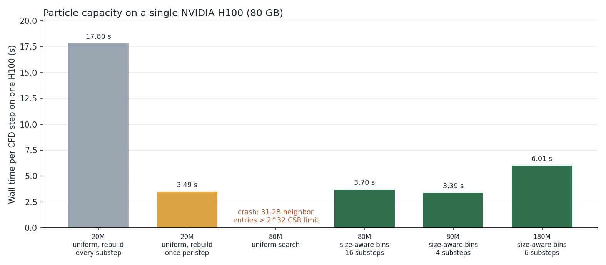

# C90 rotational-sector CFD-DEM on GPUs

GPU-accelerated coupled fluid–particle (CFD-DEM) simulation of a syringe
injector. The project spans a symmetry-reduced formulation, CUDA performance
engineering on NVIDIA H100s, and rigorous accuracy validation against the
full-cylinder simulation.

## GPU engineering highlights

| Result | Number | Details |
|---|---:|---|
| Particles on one H100 (80 GB) | **180 million** at 6.0 s/step | [capacity study](docs/gpu-scaling-and-capacity.md#1-180-million-particles-on-one-h100) |
| Neighbor-candidate reduction that fixed a 32-bit CSR overflow crash at 80M particles | **203.5×** (31.2B → 153M) | [overflow diagnosis](docs/gpu-scaling-and-capacity.md#1-180-million-particles-on-one-h100) |
| Profile-guided neighbor-list fix at 20M particles | **5.1×** step speedup | [rebuild study](docs/gpu-scaling-and-capacity.md#1-180-million-particles-on-one-h100) |
| Spatial particle sorting (Nsight-guided) | **52.8%** lower DEM-substep time | [DEM campaign](docs/gpu-performance.md#large-particle-dem-optimization-campaign) |
| GPU ELLPACK cache of a recursive Galerkin multigrid operator | **30.1%** faster step, exact to `6e-15` | [pressure solver](docs/gpu-scaling-and-capacity.md#2-accelerating-the-rotational-pressure-projection-c90) |
| Removing device–host syncs in the multigrid hierarchy | **33.2%** faster step | [pressure solver](docs/gpu-scaling-and-capacity.md#2-accelerating-the-rotational-pressure-projection-c90) |
| Best-iterate Krylov bottom solver | **2.04×** faster pressure solve | [pressure solver](docs/gpu-scaling-and-capacity.md#2-accelerating-the-rotational-pressure-projection-c90) |
| C90 sector vs. full cylinder at 0.11% pressure error | **1.28×** throughput | [pressure solver](docs/gpu-scaling-and-capacity.md#2-accelerating-the-rotational-pressure-projection-c90) |
| CUDA-aware MPI over NVLink vs. host-staged MPI (128 MiB GPU-to-GPU) | **51×** bandwidth (384 GB/s) | [CUDA-aware MPI](docs/gpu-scaling-and-capacity.md#4-cuda-aware-mpi) |
| 8-GPU halo exchange with GPU pack/unpack, CUDA-aware vs. staged | **11.2×** faster | [CUDA-aware MPI](docs/gpu-scaling-and-capacity.md#4-cuda-aware-mpi) |
| Multi-GPU strong scaling on 1–8 H100s, with root-cause analysis | measured honestly | [scaling](docs/gpu-scaling-and-capacity.md#3-multi-gpu-strong-scaling) |
| Cross-rank (two-GPU MPI) seam-contact symmetry | `2.78e-15` | [validation](docs/validation-results.md) |

Tools used: CUDA on NVIDIA H100, AMReX/MFiX-Exa, MPI, Nsight Compute, nested
GPU timers, and matched A/B testing with accuracy gates.



## Project scope

This repository documents the formulation and validation of a 90-degree
rotationally periodic sector for a coupled gas–particle cylinder calculation.
Four rotated copies of the computational sector represent a full cylinder
when the geometry, boundary data, and initial state have fourfold rotational
symmetry.

The project focuses on five coupled requirements:

- scalar fields map between the radial faces;
- vectors rotate by 90 degrees when they cross a face;
- particles wrap into the canonical sector and interact through rotational
  images;
- fluxes and particle-to-fluid sources remain conservative; and
- the pressure projection acts on the rotational quotient space.

This is a clean-room technical portfolio. It contains mathematical
descriptions, sanitized results, figures, and independent plotting tools. It
does **not** distribute the underlying simulation source, proprietary input
decks, executables, checkpoints, or raw logs.

The underlying research used private modifications to a separately obtained
MFiX-Exa source tree. Those modifications are intentionally not included.
See the [source and affiliation notice](NOTICE.md) for the distribution and
licensing boundary.


## Validation snapshot

The strongest accepted results include:

- fine quotient-operator action agreement of `1.62e-10` globally for an
  exactly fourfold-symmetric reference field;
- particle wrap and cyclic-contact symmetry errors between `6.897e-13` and
  `1.297e-14` in focused one-GPU tests;
- a cross-rank cyclic-seam contact symmetry error of `2.780e-15`;
- a focused tangential-history seam test agreeing with its rotated interior
  reference to `1.126e-13` maximum absolute vector error;
- mature one-GPU throughput of `0.363756838 s/step` over 100 fluid steps; and
- a separate large-particle campaign with profiling-guided DEM optimizations,
  including a qualified 52.78% reduction in normalized DEM-substep time from
  spatial sorting; and
- full-cylinder-equivalent force-ledger closure to `1.11022e-15 N`.

Scope matters: published coupled production results use one MPI rank.
Focused two-rank particle tests and a one-step coupled comparison pass, but
sustained coupled multi-rank pressure evolution is not qualified.

## C90 versus full cylinder

These matched snapshots compare the monodisperse 20 µm-radius cases at nearly
the same simulated time: `0.700515 s` for the full cylinder and `0.700000 s`
for the 90° sector. Both flow panels use the same `0–0.002 m/s` axial liquid
velocity range, identical plot limits, and a common physical axis scale. They
are longitudinal views near the `y = 0` plane, with `z` horizontal and `x`
vertical. The light hatched region identifies the volume occupied by the
penalized IBM piston, whose plane is at approximately `z = 1.39 mm` in these
snapshots.


The transverse view at `z = 5 mm` shows the resolved two-dimensional velocity
variation across the third spatial dimension. The full circular section and
the simulated quadrant retain the same coordinate and velocity scales.


The particle view uses the geometry extracted from the fluid volume-fraction
field and colors particles by axial velocity on a shared scale. Perspective
3D views keep the syringe axis horizontal and use identical coordinate bounds
and geometry aspect ratios. A translucent shell and complete circular end face
identify the full-360 domain; the C90 view instead exposes its two radial
rotational-boundary planes. At this instant, the full cylinder contains
432,544 particles; the sector contains
107,562, equivalent to 430,248 particles after fourfold replication. A
deterministic display subset is used only to keep the raster figure legible.


The following time-history figures provide additional qualitative context.
They are not used for the quantitative validation claims in this repository.


The repository also includes a measured-only particle-population dataset over
the common interval through approximately `0.84 s`, along with independent
plotting scripts.

## Repository map

- [`docs/formulation.md`](docs/formulation.md) — rotational mapping and
  quotient-space formulation.
- [`docs/implementation-overview.md`](docs/implementation-overview.md) —
  architecture-level design without restricted implementation detail.
- [`docs/validation-methods.md`](docs/validation-methods.md) — metrics,
  normalization, and evidence scope.
- [`docs/validation-results.md`](docs/validation-results.md) — accepted,
  sanitized result tables.
- [`docs/gpu-performance.md`](docs/gpu-performance.md) — GPU optimization
  strategy, profiling methodology, and performance/accuracy tradeoffs.
- [`docs/gpu-scaling-and-capacity.md`](docs/gpu-scaling-and-capacity.md) —
  180M-particle single-GPU capacity, pressure-solver acceleration,
  multi-GPU strong scaling, and CUDA-aware MPI benchmarks.
- [`data/benchmarks/`](data/benchmarks/README.md) — benchmark tables behind
  the performance figures.
- [`benchmarks/cuda_aware_mpi/`](benchmarks/cuda_aware_mpi/README.md) —
  standalone CUDA + MPI microbenchmark (ping-pong and GPU halo exchange).
- [`docs/limitations.md`](docs/limitations.md) — unresolved and unqualified
  behavior.
- [`data/README.md`](data/README.md) — public data schemas.
- [`scripts/README.md`](scripts/README.md) — figure reproduction.
- [`provenance/release-manifest.md`](provenance/release-manifest.md) — artifact
  status and release boundary.
- [`NOTICE.md`](NOTICE.md) — MFiX-Exa source, licensing, and affiliation
  boundary.
- [`CONTRIBUTING.md`](CONTRIBUTING.md) — clean-room contribution rules.

## Reproduce the figures

```bash
python3 -m pip install matplotlib
python3 scripts/plot_particle_population.py \
  --retention-csv data/sanitized/particle_retention_timeseries.csv \
  --count-csv data/sanitized/particle_count_timeseries.csv \
  --output-dir build/figures
```

The matched field and particle renderer accepts AMReX plotfile directories;
see [`scripts/README.md`](scripts/README.md) for its inputs and dependencies.

Run the public-data and release-hygiene checks with:

```bash
python3 -m unittest discover -s tests -v
python3 scripts/check_release.py
```

## Status

This local tree is approved for Git preparation. The time-history comparison
figures are retained as qualitative context. No MFiX-Exa source or private
source modification is included.
