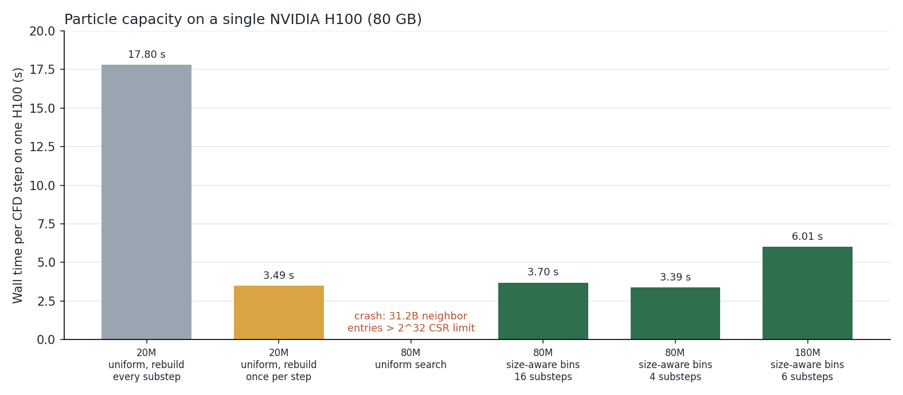
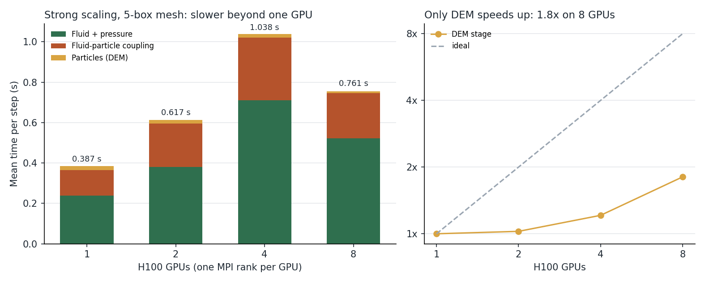
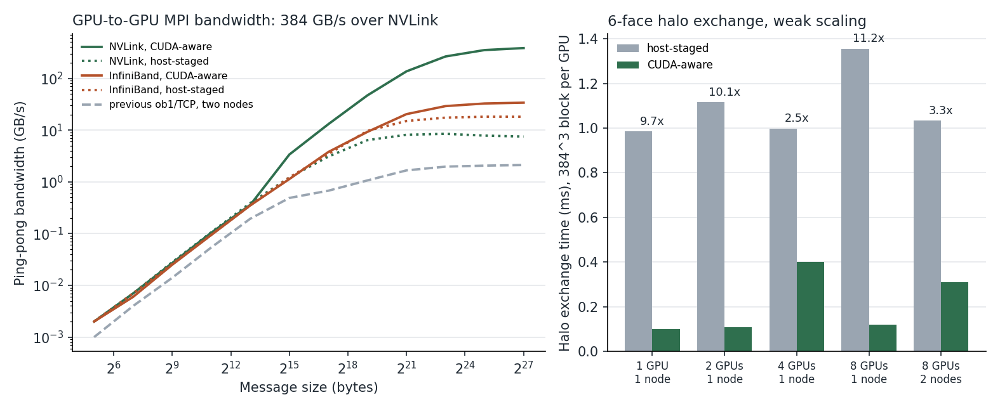

# GPU capacity, solver acceleration, and multi-GPU scaling

This page extends [GPU performance engineering](gpu-performance.md) with four
measured campaigns from the same rotational-sector CFD-DEM framework:

1. pushing one NVIDIA H100 from 20 million to 180 million particles;
2. accelerating the rotational pressure projection with a GPU sparse-operator cache,
   synchronization removal, kernel fusion, and a better Krylov bottom solver; and
3. measuring multi-GPU strong scaling and explaining why it did not pay off; and
4. measuring what CUDA-aware MPI gains over host-staged MPI on the same H100
   nodes.

Every number below comes from a completed run and a matched control. The raw
tables are in [`data/benchmarks/`](../data/benchmarks/README.md), and
[`scripts/plot_gpu_benchmarks.py`](../scripts/plot_gpu_benchmarks.py)
regenerates the figures.

## 1. 180 million particles on one H100

The particle-capacity study used a 180° sector of the same injector, with
polydisperse 6/12/40 µm particle mixtures at 20M and 80M particles (30/55/15%
by mass). The goal was to
learn how far one 80 GB H100 could go before multi-GPU decomposition became
necessary.

**20M particles: profile first, then remove the dominant cost.** A one-step
stage profile assigned 15.30 s of the 16.55 s DEM time (92.5%) to rebuilding
the neighbor list on every DEM substep. Contact kernels took only 1.22 s. The
fix rebuilds the list once per CFD step and relies on its geometric skin
between rebuilds. Rebuild intervals of 2, 4, 8, and 16 substeps were each
validated in turn:

| Neighbor-list rebuild interval | Sustained s/step | Speedup | Max. pressure change |
|---|---:|---:|---:|
| every substep (baseline) | 17.8 | 1.0× | — |
| 2 | 10.1 | 1.8× | 0.048% |
| 4 | 6.35 | 2.8× | 0.055% |
| 8 | 4.40 | 4.0× | 0.048% |
| 16 (once per CFD step) | 3.49 | **5.1×** | 0.055% |

At interval 2, force and velocity were bitwise identical after one step.

**80M particles: diagnosing a 32-bit overflow.** At 80,039,438 particles the
solver crashed with a CUDA illegal-memory-access error. A 64-bit audit of
neighbor counts, taken before the compressed-sparse-row (CSR) scan, found
**31,222,780,504** candidate entries. That is 7.27× the `2^32 − 1` limit of the
32-bit CSR offsets, and the index list alone would have needed about 125 GB.
So the crash was a wrapped write while filling the list, not a fault in the
contact-force kernel. Widening the offsets to 64 bits could not have fixed it,
because the list would still not fit in 80 GB.

The repair was algorithmic. A size-aware neighbor search sorts particles into
three diameter bins with refinement ratios 6, 3, and 1. Small–small pairs then
no longer search out to the 40 µm radius of the largest particles.

| Metric | Uniform search | Size-aware bins | Change |
|---|---:|---:|---:|
| Neighbor candidate entries | 31.2 billion | 153.4 million | **203.5× fewer** |
| Maximum list length per particle | 492 | 4 | — |
| Result | crash (overflow) | stable, 3.70 s/step | runs |

A permanent guard now aborts with a clear message if the count ever exceeds
the 32-bit limit, instead of writing past the end of the list.

Single-variable controls tuned the remaining settings:

- A coarser `5 3 1` bin layout was rejected because it was 23% slower
  (4.54 s/step).
- Cutting DEM substeps from 16 to 4 sped the step up by 8.4% (3.39 s/step). In
  a matched 30-step check, velocity stayed within 0.001% and piston pressure
  within 0.136%.
- A coarser particle-force update interval was rejected. It saved only 0.02
  s/step and shifted pressure by 2.7–4.5%.

**180M particles: memory-bound capacity.** A 4.5/10/40 µm timing cloud
with 180,000,037 particles, using size-aware bins with refinement ratios 8, 4,
and 1, ran stably at **6.01 s/step** on one H100. Of that, DEM took 4.49 s,
of which the neighbor-list rebuild was 4.07 s. Fluid took 1.27 s and coupling
0.26 s. Peak device memory was 63.6 GB of 81.1 GB. At 180M the remaining
bottleneck is the neighbor-list rebuild. This is a capacity and timing result
only: its particles were laid out in slabs, not as a mixed production cloud.

A next step would be to reuse the neighbor list across CFD steps. A design
review rejected that as unsafe for this geometry. About 2.0 million rotating
seam-image particles continuously enter and leave the image band. Keeping their
list indices stale breaks correctness, and refreshing them invalidates the
list. Doing this properly needs a new cyclic-aware Verlet list with a stable
mapping from each source particle to its image, not a small patch. That
decision is documented here rather than shipped as an unsafe option.

## 2. Accelerating the rotational pressure projection (C90)

In the C90 sector, the pressure Poisson equation is solved on the rotational
quotient space `PᵀAP`. The coarse levels of the multigrid hierarchy apply a
recursive Galerkin operator `R PᵀAP I`. A nested GPU timer breakdown over about
48,000 recursive calls found where the time went:

| Recursive coarse-operator stage | Share of time |
|---|---:|
| Interpolation (prolongation) | 42.7% |
| Restriction | 27.9% |
| Fine-level operator apply | 9.9% |
| Fine-level `P` reconstruction | 2.9% |
| Buffer clear | 1.5% |

Each change below was tested as a matched on/off A/B on the same hardware. A
change was accepted only if step-1 force was unchanged and convergence was
preserved:

| Optimization | Control | Candidate | Gain |
|---|---:|---:|---:|
| Remove device-to-host syncs in the one-rank, one-box hierarchy | 13.88 s | 9.27 s | **33.2%** |
| Fuse interpolation with output initialization | 7.99 s | 7.60 s | 4.9% |
| Fuse the fine-level `P` reconstruction in place | 7.60 s | 7.26 s | 4.5% |
| Assemble the recursive Galerkin operator once as a width-48 ELLPACK sparse matrix on the GPU | 7.26 s | 5.07 s | **30.1%** |

The ELLPACK cache stores 921,370 exact entries, with a maximum row width of 42.
Its action matches the recursive operator to `6.2e-15`, with the cached matrix
built in 3.5 s. A graph audit first measured the operator's true sparsity, which
showed that a dense response cache would need 783 components. It also rejected
a cheaper 3-color cache, which was wrong by `1.6` because the coupling extends
beyond the assumed block.

Rejected candidates included a parameter cache that was 1.8% slower, a fused
restriction/quotient transfer that was exact but did not speed up the step,
and removing a buffer clear, which stalls the solve because embedded-boundary
cells retain stale values.

**A better bottom solver.** The coarsest-level BiCGStab solve was replaced by a
variant that keeps its best iterate and allows an early exit only after at
least a 10× residual reduction. Over 90 coupled steps (11–100), this cut
summed nodal-solve time from 1822.7 s to 895.5 s (**2.04×**) and wall time
from 31:31 to 16:16 (**1.94×**). Step-100 pressure stayed within `0.015%` of
the full-cylinder reference.

**Net result.** With these solver paths, the accurate C90 sector runs steps
21–100 in 254.6 s versus 325.8 s for the full cylinder. That is **1.28× higher
throughput**, with a mean pressure error of `0.110%` against the full cylinder.

## 3. Multi-GPU strong scaling

The two-rank, two-GPU correctness tests in
[validation results](validation-results.md) show that the rotational seam is
correct across MPI ranks. In particular, cross-rank contact symmetry holds to
`2.78e-15` and one- versus two-rank piston force agrees to `3.96e-9`. In a CPU audit, a
distributed gather path for the cyclic pressure operator converged to identical
global norms on one and two ranks.

Strong scaling was then measured on a 45° sector with 55,954 particles, using
1, 2, 4, and 8 H100s for 100 steps each:

| GPUs | Fluid | Coupling | DEM | Total s/step | vs. 1 GPU |
|---:|---:|---:|---:|---:|---:|
| 1 | 0.239 | 0.126 | 0.019 | **0.387** | 1.00× |
| 2 | 0.380 | 0.215 | 0.019 | 0.617 | 0.63× |
| 4 | 0.710 | 0.311 | 0.016 | 1.038 | 0.37× |
| 8 | 0.523 | 0.222 | 0.011 | 0.761 | 0.51× |

**Diagnosis.**

- The DEM stage does strong-scale, reaching 1.8× on 8 GPUs.
- The mesh has only five fluid boxes, so eight ranks cannot all receive fluid
  work.
- The fluid solve, the rotational pressure coupling, and the particle-to-fluid
  exchange become communication-bound. Together they cost more than one GPU's
  entire step.

The production decision was therefore to stay on one H100 and spend effort on
the single-GPU optimizations above. A multi-GPU speedup would first require:

- a decomposition with many more fluid boxes than ranks;
- a communication path for the rotational coupling that avoids gathering to
  one rank; and
- a sustained multi-rank validation of the coupled pressure solve, which is
  listed as unqualified in [limitations](limitations.md).

These scaling runs used Open MPI's `ob1` PML over TCP and shared-memory BTLs,
which stage every GPU message through host memory. Section 4 measures the
CUDA-aware alternative directly.

## 4. CUDA-aware MPI

A distributed GPU solver spends its communication time in ghost-cell (halo)
exchanges. With an MPI that is not CUDA-aware, every message makes a
device→host copy, a host send, and a host→device copy. A standalone
microbenchmark,
[`benchmarks/cuda_aware_mpi`](../benchmarks/cuda_aware_mpi/README.md),
compares that host-staged path with passing GPU pointers straight to MPI. The
run used Open MPI 4.1.6 + UCX 1.17 on H100 nodes with eight NVLink-connected
GPUs each, joined by InfiniBand. Every received buffer was verified on the GPU.

**Point-to-point bandwidth at 128 MiB** (ping-pong between two GPUs):

| Link | CUDA-aware (GPU pointers) | Host-staged | Previous `ob1`/TCP path | CUDA-aware vs. staged |
|---|---:|---:|---:|---:|
| Two GPUs in one node (NVLink) | **384.3 GB/s** | 7.50 GB/s | 2.01 GB/s | **51×** |
| Two nodes (InfiniBand) | **33.8 GB/s** | 18.1 GB/s | 2.11 GB/s | 1.9× |

Across nodes the CUDA-aware path is also **16×** faster than the `ob1`/TCP
configuration used for the strong-scaling runs in section 3. For tiny messages
there is no gain: 8-byte latency is about 18–20 µs in every mode. The benefit
comes from bandwidth-bound transfers such as ghost-cell faces.

**Six-face halo exchange**, with a 384³ double block per GPU (1.18 MB per
face), packed and unpacked by GPU kernels. Per-GPU work is fixed, so this is
weak scaling:

| GPUs | Nodes | CUDA-aware | Host-staged | Speedup |
|---:|---:|---:|---:|---:|
| 1 | 1 | 0.101 ms | 0.986 ms | 9.7× |
| 2 | 1 | 0.110 ms | 1.116 ms | 10.1× |
| 4 | 1 | 0.402 ms | 0.998 ms | 2.5× |
| 8 | 1 | **0.121 ms** | 1.355 ms | **11.2×** |
| 8 | 2 | 0.311 ms | 1.034 ms | 3.3× |

On one node the CUDA-aware exchange stays near 0.1 ms from 1 to 8 GPUs, while
the staged exchange grows. The 4-GPU case is an unexplained outlier that was
not investigated further. Splitting the 8 GPUs over two nodes puts some faces
on InfiniBand and raises the time to 0.31 ms. That is still 3.3× faster than
staging.

**What the fabric did and did not support.** These findings are part of the
result:

- **GPUDirect RDMA was unavailable.** The InfiniBand adapters rejected
  registration of GPU memory. With `UCX_IB_GPU_DIRECT_RDMA=no`, UCX still
  accepts device pointers but pipelines them through host memory internally.
  The inter-node CUDA-aware numbers are therefore not GPUDirect numbers, and
  real GPUDirect RDMA hardware would be expected to do better.
- **UCX's UD transport timed out** on this fabric, including for wire-up
  between nodes. Pinning `UCX_TLS` (`cuda_ipc` within a node, RC between
  nodes) made every run complete. One node consistently failed the
  inter-node test and was excluded.

**Scope.** This is a communication microbenchmark, not a coupled CFD-DEM
timing. It shows the communication path a decomposed solver would use, but it
does not change the section 3 conclusion. The C90 production case still runs
fastest on one GPU, and sustained coupled multi-rank pressure solves remain
unqualified (see [limitations](limitations.md)).

## Engineering practices shown

- **Profile before optimizing.** Stage timers, nested GPU timers, Nsight
  Compute, and graph-sparsity audits chose every target.
- **Validate each change against a matched control.** Each A/B checked force,
  pressure, particle state, and particle count, not just wall time.
- **Fix the cause of a crash, not the symptom.** A 32-bit CSR overflow was
  traced to an algorithmic candidate explosion and fixed by size-aware binning.
- **Accept the accuracy budget explicitly.** Faster but less accurate
  configurations were rejected with documented error numbers.
- **Measure the communication path directly.** A CUDA-aware MPI
  microbenchmark quantified the gain over host staging and exposed fabric
  limitations, including missing GPUDirect RDMA and a broken UD transport.
- **Report negative results.** Multi-GPU slowdowns, slower fusions, and unsafe
  list reuse are documented alongside the wins.
